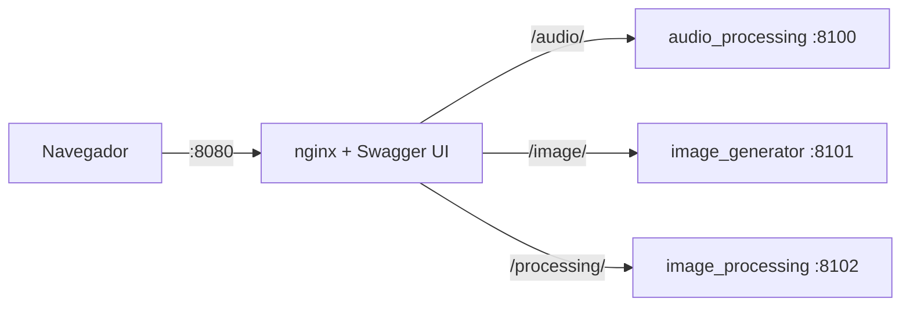

# App — `gateway` (Swagger global)

Portal único con la documentación interactiva de todas las APIs de Paimon.

- **Carpeta**: `gateway/`
- **README detallado**: [`../../gateway/README.md`](../../gateway/README.md)
- **Puerto**: `8080` (`SWAGGER_HOST_PORT`), solo en `127.0.0.1`

## Qué resuelve

Hasta ahora cada app tenía su Swagger en su propio puerto (`/docs`). El portal
los reúne en un único origen:

```text
http://localhost:8080/            → Swagger UI con selector de API
http://localhost:8080/audio/…     → proxy a audio_processing
http://localhost:8080/image/…     → proxy a image_generator
http://localhost:8080/processing/…→ proxy a image_processing (remove-bg)
```

Al compartir origen no hay CORS y *Try it out* funciona igual que en el Swagger
de cada servicio. El portal solo lista las APIs que responden en ese momento.

## Arquitectura



- **nginx** sirve Swagger UI (assets empaquetados en la imagen, sin CDN) y hace
  de proxy inverso.
- `network_mode: host` + `listen 127.0.0.1`: alcanza las APIs publicadas en el
  loopback sin abrir nada a la red.
- `dev.js` inyecta los puertos reales (`AUDIO_PORT`, `IMAGE_PORT`,
  `PROCESSING_PORT`) y la clave compartida (`API_KEY`, primera de `API_KEYS`).

## Uso

```bash
node dev.js --swagger --processing   # portal + quita-fondo
node dev.js --swagger                # portal con lo que ya esté corriendo
node dev.js                          # todo
```

Aliases: `--docs`, `--gateway`, `--portal`.

## Autenticación

Las APIs aceptan `X-API-Key` (ver [`../operations.md`](../operations.md)). El
portal toma la primera clave de `API_KEYS` en el `.env` de la raíz y la añade a
cada petición proxeada, así que en Swagger no hace falta pulsar *Authorize*.
Para llamar directamente a una API sin el portal sí hay que enviar la clave.

## Añadir una API

Ver [`../../gateway/README.md`](../../gateway/README.md#añadir-otra-api):
`location` en nginx, puerto en el compose, `GATEWAY_TARGETS` en `dev.js` y la
entrada en `html/index.html`.
