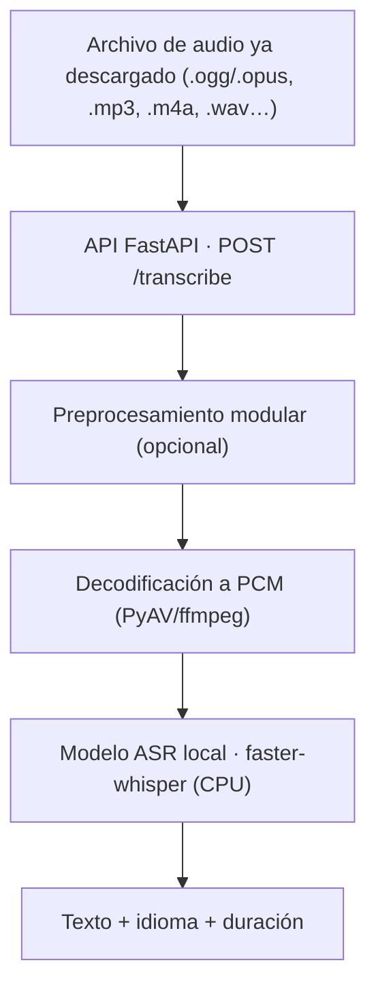

# `audio_processing` — transcripción de voz a texto (detalle técnico)

Documentación **técnica e interna** del servicio de transcripción y
preprocesamiento de audio de Paimon. Explica el algoritmo completo: qué pasa
desde que llega un archivo de audio hasta que sale el texto.

- Para el resumen de la app (endpoints, configuración): [`../apps/audio_processing.md`](../apps/audio_processing.md).
- Para el manual de uso del código: [`../../audio_processing/README.md`](../../audio_processing/README.md).

## Índice

| Documento | Contenido |
|-----------|-----------|
| [`transcription.md`](transcription.md) | **El algoritmo de `POST /transcribe` paso a paso**: validación → preprocesado (opcional) → decodificación → log-mel → decoder de Whisper → postprocesado. Diagramas de flujo y de secuencia. |
| [`preprocessing.md`](preprocessing.md) | Los **módulos de preprocesamiento** (pipes-and-filters), el `AudioClip` común, los presets y cómo se encadenan. |
| [`providers.md`](providers.md) | La **abstracción de proveedores**, el motor local `faster-whisper` y su configuración. |

## Panorama

El servicio es **solo transcripción** (no traduce, no genera voz) y **local-first**
(corre en CPU, sin GPU). Los proveedores cloud se añadirán detrás de la misma
interfaz (ver [`providers.md`](providers.md)). El bot de WhatsApp es otra
herramienta: aquí no vive nada del bot.

## Qué hace cada capa

| Capa | Carpeta | Responsabilidad |
|------|---------|-----------------|
| API HTTP | `audio_processing/api/app/main.py` | Endpoints, validación, orquestación, serialización. |
| Dependencias | `.../deps.py` | Token, validación de subida, decodificación. |
| Núcleo de audio | `.../audio/` | `AudioClip`, decodificación (PyAV), WAV, resample (soxr). |
| Preprocesamiento | `.../preprocessing/` | Módulos independientes + pipeline + presets. |
| Proveedores | `.../providers/` | `TranscriptionProvider` (ABC) y el motor local. |
| Evaluación | `audio_processing/eval/` | Banco de WER para decidir con datos. |

## Valores actuales por defecto

| Ajuste | Default | Nota |
|--------|---------|------|
| Modelo | `small` | Mejor punto calidad/latencia medido (ver `transcription.md`). |
| VAD | activado | `vad_filter=true` (Silero). |
| `condition_on_previous_text` | `false` | Evita bucles de repetición. |
| `beam_size` | `5` | |
| Idioma | `es` (`AUDIO_DEFAULT_LANGUAGE`) | `auto` = autodetección. |
| `preprocess` | `none` | Sin limpieza previa salvo que se pida. |
| Dispositivo / precisión | `cpu` / `int8` | Sin GPU en el host. |
