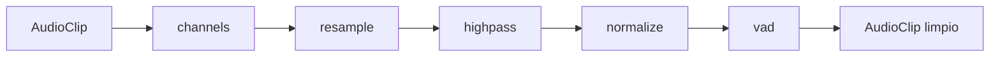
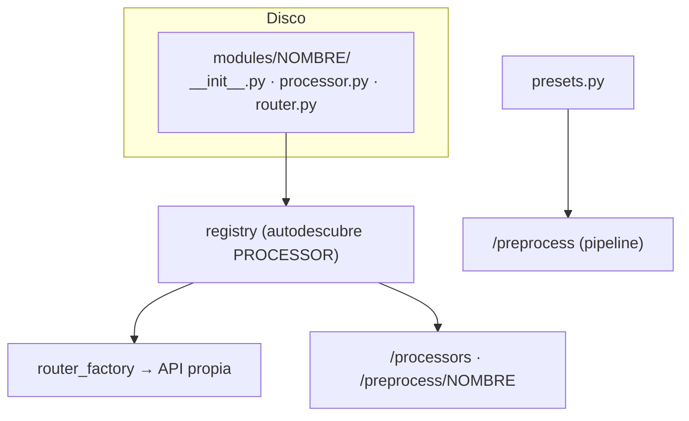

# Preprocesamiento modular

El preprocesamiento es una capa de **pipes-and-filters**: cada técnica es un
**módulo independiente** que consume y produce un `AudioClip`, y los módulos se
pueden **encadenar** en un pipeline. Todos viven en
`audio_processing/api/app/preprocessing/`.

## Modelo de datos

```python
@dataclass
class AudioClip:
    samples: np.ndarray   # float32, forma (canales, muestras), rango [-1, 1]
    sample_rate: int
```

Todo el pipeline usa este tipo común (`api/app/audio/types.py`), de modo que los
pasos no se acoplan a bytes, ficheros ni al motor de ASR. Los pasos que lo
necesitan devuelven además `Segment` y `metrics`.

## Interfaz de un módulo: `Processor`

`preprocessing/base.py`:

```python
class Processor(ABC):
    name: ClassVar[str]
    description: ClassVar[str] = ""
    params_model: ClassVar[type[BaseModel]] = EmptyParams
    required_packages: ClassVar[tuple[str, ...]] = ()

    @classmethod
    def available(cls) -> bool: ...          # ¿están sus dependencias?

    @abstractmethod
    def process(self, clip: AudioClip, params) -> ProcessorResult: ...
```

`ProcessorResult` = `clips` (salida), `segments` (tramos etiquetados) y `metrics`
(dict de diagnóstico). Un módulo es **barato de construir**; los modelos pesados se
cargan de forma perezosa.

## Composición: `Pipeline`

`preprocessing/pipeline.py` encadena pasos: la salida de uno alimenta al
siguiente. `normalize_spec` acepta tres formas de paso:

```
"resample"                              # nombre suelto, sin parámetros
{"name": "resample", "params": {...}}
{"resample": {...}}
```



## Descubrimiento y API propia

- `registry.py` recorre `modules/*` con `pkgutil` y recoge el atributo
  `PROCESSOR` de cada carpeta → `PROCESSORS` (ordenado por nombre).
- `router_factory.py` genera, para **cada** módulo, una API propia con la misma
  forma: `GET /preprocess/<módulo>` (info + `params_schema`) y
  `POST /preprocess/<módulo>` (aplica el módulo; campos `file`, `params`,
  `include_audio`).
- `api.py` monta todo: `/processors`, `/presets`, `/preprocess` (pipeline) y las
  rutas de cada módulo.

**Añadir un módulo** = crear su carpeta con `__init__.py` (que exporta
`PROCESSOR`), `processor.py` y `router.py`. No hay que registrar nada a mano.



## Módulos

| Módulo | Qué hace | Parámetros (default) | Disponible con |
|--------|----------|----------------------|----------------|
| `decode` | Decodifica cualquier formato a PCM (sin alterar). | — | base |
| `channels` | Downmix a mono o primer canal. | `mode` = `mono` | base |
| `resample` | Remuestrea. | `sample_rate` = `16000` | base (`soxr`) |
| `highpass` | Filtro paso-alto Butterworth (quita retumbe). | `cutoff` = `80.0`, `order` = `4` | base (`scipy`) |
| `normalize` | Ajusta nivel. | `mode` = `peak`, `target_db` = `-1.0` (`rms`/`lufs`) | base (`lufs`→`pyloudnorm`) |
| `analyze` | Métricas de calidad. | — | base |
| `vad` | Detecta voz (Silero); recorta o separa. | `threshold`=`0.5`, `mode`=`trim`/`split` | base |
| `denoise` | Reduce ruido de fondo. | `backend`=`auto`, `strength`=`1.0` | base (`noisereduce` opcional) |
| `dereverb` | Quita reverberación tardía (WPE). | `taps`=`10`, `delay`=`3`, `iterations`=`3` | extras (`nara_wpe`) |
| `diarize` | Etiqueta hablantes (`ecapa`/`pyannote`). | `backend`=`auto` | extras / `HF_TOKEN` |
| `separate` | Separa fuentes (Demucs); aísla la voz. | `model`=`htdemucs`, `stems`=`["vocals"]` | extras (`demucs`) |

### Métricas de `analyze`

`duration`, `sample_rate`, `channels`, `samples`, `peak`, `peak_db`, `rms`,
`rms_db`, `dc_offset`, `clipping_ratio`, `silence_ratio`, `estimated_snr_db`,
`spectral_centroid_hz` y `band_energy_ratio` (energía por bandas: `0-300`,
`300-1000`, `1000-3000`, `3000-8000`, `8000-24000` Hz).

## Presets (`preprocessing/presets.py`)

| Preset | Pasos |
|--------|-------|
| `raw` | *(ninguno)* |
| `minimal` | `channels(mono) → resample(16000) → highpass(80) → normalize(peak, -1)` |
| `clean` | `minimal` + `vad` |
| `noisy` | `channels → denoise(auto) → resample → highpass → normalize → vad` |

Se usan tanto en `POST /preprocess` como en `POST /transcribe?preprocess=<preset>`.

## Disponibilidad y errores

Los módulos opcionales **no rompen nada** si falta su dependencia: `available()`
devuelve `False`, se reportan como no disponibles en `/processors` y responden
`503` con un mensaje claro. Los errores de un paso se propagan como
`ProcessorError` (→ JSON con `detail` y el `status_code` correspondiente).

## Qué dice el banco de evaluación

`audio_processing/eval/` mide el WER por variante sobre voz real. Conclusiones
vigentes:

- **`clean` (cadena mínima + VAD) es el mejor preset** por defecto.
- `minimal` no mejora por sí solo; el **`denoise` no debe activarse por defecto**
  (empeora salvo con ruido severo). Si se usa, `noisereduce` > `spectral`.
- En **audio de teléfono** (nota de voz), `minimal` (highpass + normalize) ayuda a
  quitar el retumbe de baja frecuencia. Ver la receta en
  [`../apps/audio_processing.md`](../apps/audio_processing.md).
