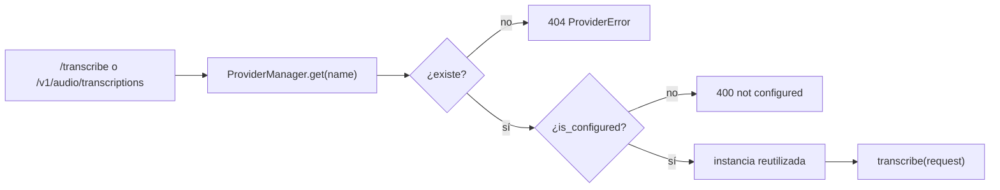

# Proveedores de transcripción

La transcripción está detrás de una interfaz común, para que **local** y **cloud**
convivan sin cambiar la API. Código en `audio_processing/api/app/providers/`.

## Contrato: `TranscriptionProvider`

`providers/base.py`:

```python
class TranscriptionProvider(ABC):
    name: ClassVar[str]

    def __init__(self, settings: Settings) -> None: ...

    @classmethod
    @abstractmethod
    def is_configured(cls, settings: Settings) -> bool: ...

    @classmethod
    def default_model(cls, settings) -> str | None: ...

    @abstractmethod
    async def transcribe(self, request: TranscribeRequest) -> TranscriptResult: ...

    async def aclose(self) -> None: ...
```

- Debe ser **barato de construir**; los recursos pesados (modelos) se cargan de
  forma perezosa y se liberan en `aclose`.
- `TranscriptResult` es el resultado neutro: `provider`, `model`, `text`,
  `language`, `language_probability`, `duration`, `segments`, `metadata`.
- `ProviderError` (y `ProviderNotConfiguredError`) se traducen a JSON con
  `detail` y el `status_code` correspondiente.

## Registro y ciclo de vida

`providers/registry.py`:

- `PROVIDER_CLASSES` es la lista de proveedores (hoy solo `LocalWhisperProvider`).
- `ProviderManager.get(name)` valida el nombre, comprueba `is_configured`, y
  **instancia una sola vez** y reutiliza (`_instances`). Al terminar la app,
  `aclose()` libera todos.
- `configured_names()` alimenta `/health` y `/providers`.



## Motor local: `LocalWhisperProvider`

`providers/local_whisper.py`, sobre **faster-whisper** (CTranslate2), pensado para
CPU.

```python
class LocalWhisperProvider(TranscriptionProvider):
    name = "local"
    ...
    async def transcribe(self, request):
        async with self._lock:                     # serializa el acceso al modelo
            return await asyncio.to_thread(self._transcribe_sync, request)
```

Puntos clave del diseño:

| Aspecto | Decisión | Por qué |
|---------|----------|---------|
| Concurrencia | `asyncio.Lock` + `asyncio.to_thread` | `WhisperModel` no es seguro en paralelo y la inferencia es bloqueante (CPU). |
| Carga | Perezosa, la primera vez | Arrancar la API no descarga ni carga el modelo. |
| Caché | `dict[str, WhisperModel]` por nombre | Cambiar de modelo por petición sin recargar los ya usados. |
| Ubicación | `WHISPER_MODEL_DIR` (volumen `./api/models`) | No re-descargar; no versionar los pesos. |
| Precisión | `compute_type="int8"` en `cpu` | Lo más rápido en CPU; `float32` si se prioriza precisión. |

Además, el proveedor resuelve los parámetros de decodificación: usa lo que venga
en la petición; si es `None`, cae al valor de `Settings` (así el endpoint OpenAI
también hereda los defaults del motor).

### Modelos y coste

Disponibles por nombre: `tiny`, `base`, `small`, `medium`, `large-v3`,
`large-v3-turbo`. El default es **`small`**. En este host (CPU, `int8`):

| Modelo | Latencia (~6 s de audio) | Nota |
|--------|--------------------------|------|
| `base` | ~5-7 s | Rápido, poca calidad en coloquial. |
| `small` | ~14-18 s | **Default**: mejor punto calidad/latencia. |
| `medium` / `large-v3-turbo` | inviable en CPU | Mejor calidad; requiere GPU o cloud. |

Ver el A/B y las palancas en [`transcription.md`](transcription.md).

## Endpoints de estado

| Ruta | Devuelve |
|------|----------|
| `GET /health` | `status`, `default_provider`, `configured_providers`. |
| `GET /providers` | Lista con `name`, `configured`, `default` y `model`. |
| `GET /` | Índice de endpoints (fuera de OpenAPI). |

## Compatibilidad con OpenAI

`POST /v1/audio/transcriptions` usa **siempre** el proveedor por defecto (hoy
`local`), por lo que cualquier SDK de OpenAI puede apuntar a esta API sin conocer
nuestro contrato. No soporta `preprocess` ni selección de proveedor.

## Cloud (a futuro)

Los proveedores cloud (OpenAI, Groq, …) se añadirán como clases nuevas que
implementan `TranscriptionProvider` y se registran en `PROVIDER_CLASSES`. La API,
la validación y el preprocesamiento **no cambian**: solo se elige otro proveedor
con el campo `provider` o `AUDIO_PROVIDER`.
