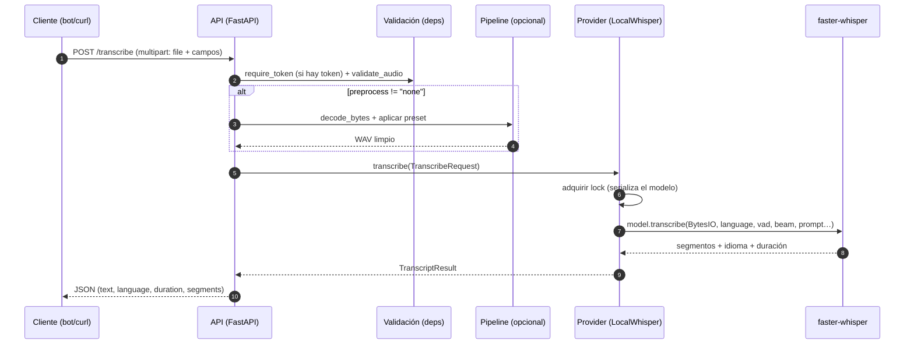
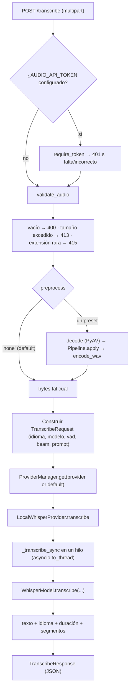
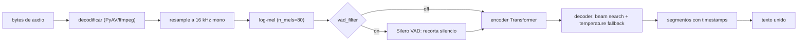

# El algoritmo de `POST /transcribe`

Este documento describe **qué pasa, en orden, cuando se envía un audio** a la API
de transcripción, y **qué hace cada parte** del algoritmo.

- Endpoint principal: `POST /transcribe` (`audio_processing/api/app/main.py`).
- Endpoint compatible OpenAI: `POST /v1/audio/transcriptions` (mismo motor).

## Contrato

- **Entrada**: `multipart/form-data` con el campo `file` (audio) y varios campos
  opcionales (`language`, `model`, `provider`, `verbose`, `vad`, `beam_size`,
  `condition_on_previous_text`, `initial_prompt`, `preprocess`).
- **Salida**: JSON con `text` (la transcripción), `language`,
  `language_probability`, `duration` y, si `verbose=true`, `segments[]` con tiempos.

## Diagrama de secuencia



## Flujo paso a paso



### 1. Autenticación (opcional)

`require_token` (`deps.py`) exige `Authorization: Bearer <token>` **solo si**
`AUDIO_API_TOKEN` está definido; en caso contrario, la ruta es abierta. Se aplica
a `/transcribe` y `/v1/audio/transcriptions` (el preprocesamiento no lo exige).

### 2. Validación de la subida

`validate_audio` (`deps.py`) comprueba, antes de tocar el audio:

| Chequeo | Condición | Respuesta |
|---------|-----------|-----------|
| Contenido | `len(content) == 0` | `400` |
| Tamaño | `> AUDIO_MAX_UPLOAD_MB` (25 MB) | `413` |
| Extensión | no está en `ALLOWED_EXTENSIONS` | `415` |

Extensiones aceptadas: `.wav .mp3 .m4a .mp4 .aac .ogg .oga .opus .flac .webm`.

### 3. Preprocesamiento (opcional)

Si `preprocess` es distinto de `none`/vacío, se limpia el audio **antes** de
transcribir (`main.py`):

1. `decode_upload(content)` → `decode_bytes` (PyAV) → `AudioClip` float32.
2. `Pipeline.from_spec(preset, settings).apply(clip)` → audio procesado.
3. `encode_wav(clips[0])` → bytes WAV que reemplazan al contenido original.

El detalle de los módulos y presets está en [`preprocessing.md`](preprocessing.md).
Por defecto `preprocess=none`: los bytes van tal cual al motor.

### 4. Construcción de la petición interna

`TranscribeRequest` (`schemas.py`) transporta el audio y los ajustes:

| Campo | Origen | Efecto |
|-------|--------|--------|
| `data` | bytes (crudos o preprocesados) | Audio a transcribir. |
| `language` | form / `AUDIO_DEFAULT_LANGUAGE` | Idioma forzado (`auto` → `None` = autodetección). |
| `model` | form / `LOCAL_WHISPER_MODEL` | **Selecciona el modelo** a cargar. |
| `vad` | form (o `None` → settings) | `vad_filter` del decoder. |
| `beam_size` | form | Ancho de búsqueda del decoder. |
| `condition_on_previous_text` | form | Condicionar cada ventana al texto previo. |
| `initial_prompt` | form | Vocabulario/contexto para sesgar el decoder. |
| `verbose` | form | Incluir `segments[]` en la respuesta. |

### 5. Selección del proveedor

`ProviderManager.get(name)` (`providers/registry.py`) busca el proveedor por
nombre, verifica `is_configured` e **instancia y reutiliza** una única instancia.
Hoy solo existe el proveedor `local` (`LocalWhisperProvider`).

### 6. El motor local: `LocalWhisperProvider`

`providers/local_whisper.py`:

- La transcripción se ejecuta **fuera del event loop** con `asyncio.to_thread`
  (es bloqueante y consume CPU).
- Se **serializa** con un `asyncio.Lock`: el objeto `WhisperModel` no es seguro
  ante usos concurrentes.
- El modelo se **carga de forma perezosa** la primera vez y se **cachea por
  nombre** (permite cambiar de modelo por petición sin recargar los ya usados).
- Resuelve los parámetros: lo que venga en la petición; si no, el valor de
  `Settings` (así el endpoint OpenAI también hereda los defaults).

```python
model = self._model_for(request.model or settings.local_whisper_model)
model.transcribe(
    io.BytesIO(request.data),
    language=request.language,          # None = autodetección
    task="transcribe",                  # nunca "translate"
    vad_filter=vad,                     # Silero VAD
    beam_size=beam,
    condition_on_previous_text=cond,
    initial_prompt=prompt,              # vocabulario del dominio
)
```

### 7. Dentro de `faster-whisper`

`WhisperModel.transcribe` (CTranslate2) hace, en orden:



| Etapa | Qué hace |
|-------|----------|
| Decodificación | Abre el contenedor (ogg/opus, mp3, …) con `PyAV`/ffmpeg y extrae PCM. |
| Remuestreo | Lleva el audio a **16 kHz mono**, la frecuencia nativa de Whisper. |
| Log-mel | Calcula el espectrograma mel (80 bandas), la entrada del modelo. |
| VAD (opcional) | **Silero VAD** descarta silencio: menos cómputo y menos alucinaciones. |
| Encoder | Transformer que codifica el espectrograma en representaciones latentes. |
| Decoder | Genera tokens con **búsqueda por haz** (`beam_size`) y *fallback* de temperatura; el `initial_prompt` sesga el vocabulario. |
| Salida | Segmentos `(start, end, text)`; se concatenan en `text`. |

### 8. Postprocesado y respuesta

- El proveedor une el texto de los segmentos (`"".join(...).strip()`), toma
  `language`, `language_probability` y `duration` del objeto `info`, y devuelve un
  `TranscriptResult`. Los `segments` solo se incluyen si `verbose=true`.
- `to_response` (`main.py`) construye el JSON final: `id`, `provider`, `model`,
  `created`, `preprocess`, `text`, `language`, `language_probability`, `duration`,
  `segments[]`.

```json
{
  "id": "…", "provider": "local", "model": "small", "created": 1791649328,
  "preprocess": null, "text": "…", "language": "es",
  "language_probability": 1.0, "duration": 12.31, "segments": []
}
```

## Parámetros de decodificación

| Parámetro | Default | Qué hace | Efecto medido |
|-----------|---------|----------|---------------|
| `model` | `small` | Tamaño del modelo ASR. | Dominante: `base`→`small` bajó el WER de **0.110 a 0.041**. |
| `vad` | `true` | VAD Silero antes de decodificar. | Con `small`: 0.041 → **0.023** (ayuda sobre todo con ruido). |
| `condition_on_previous_text` | `false` | Usar el texto previo como contexto. | `false` evita bucles (0.116 → 0.110). |
| `beam_size` | `5` | Ancho de búsqueda. | Más = mejor pero más lento; `1` = más rápido. |
| `initial_prompt` | *(vacío)* | Vocabulario/contexto. | **La palanca clave en coloquial** (0.32 → 0.05 en una nota real). |
| `language` | `es` | Idioma forzado. | Evita autodetección errónea en clips cortos. |

> **Regla de oro del `initial_prompt`**: una **lista separada por comas** de
> palabras del dominio (nombres, jerga). **No** la frase esperada completa: Whisper
> la trata como texto previo, "continúa" y puede **saltarse el audio**.

## Coste en CPU

Medido en el host (sin GPU), clip de ~6 s, `compute_type=int8`:

| Modelo | Latencia aprox. | WER global (voz real) |
|--------|-----------------|------------------------|
| `base` | ~5-7 s | 0.110 |
| `small` | ~14-18 s | 0.023 (con VAD) |

`medium`/`large-v3-turbo` darían mejor calidad pero **son inviables en CPU** aquí
(`turbo` superó los 10 min). Cuando haya GPU o proveedor cloud, se activan por la
misma interfaz.

## Errores comunes

| Código | Cuándo |
|--------|--------|
| `401` | `AUDIO_API_TOKEN` configurado y el Bearer falta o no coincide. |
| `404` | Proveedor desconocido (`provider=...`). |
| `400` | Audio vacío, no decodificable, modelo inválido o proveedor no configurado. |
| `413` | Supera `AUDIO_MAX_UPLOAD_MB`. |
| `415` | Extensión no soportada. |
| `422` | Falta `file` o un parámetro no cumple el esquema (p. ej. `sample_rate`). |
| `502` | Fallo del motor al transcribir. |

Errores del motor que **no** son 500: un modelo desconocido devuelve `400`
indicando los válidos (`tiny`, `base`, `small`, `medium`, `large-v3`,
`large-v3-turbo`).

> **Swagger**: si el campo `model` aparece relleno con `string`, es un valor de
ejemplo cacheado por el navegador. Recarga `/docs` (o pulsa *Try it out* de
nuevo); con la versión actual el default es `small` y `whisper-1` se acepta como
"modelo por defecto".

## Endpoint compatible con OpenAI

`POST /v1/audio/transcriptions` (`main.py`) reutiliza el mismo proveedor y
respeta los defaults de `Settings`. Acepta `file`, `model`, `language`,
`response_format` (`json` | `text` | `verbose_json`), `prompt` y `temperature`
(estos dos últimos se aceptan por compatibilidad pero **aún no se usan**).
Devuelve `{"text": …}`, texto plano, o texto + idioma/duración/segmentos.
