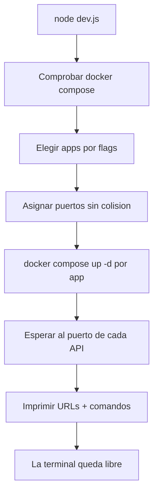

# Lanzador `dev.js`

`dev.js` es el **punto de entrada único** para levantar los aplicativos de Paimon.
Delega en `docker compose` (cada app es un stack propio), así que **no gestiona
procesos ni PIDs**: Docker se encarga del ciclo de vida de los contenedores.

```bash
node dev.js
```

## Requisitos

- Node.js.
- Docker con Compose v2 (`docker compose version` debe responder).

Si `docker compose` no está disponible, el script aborta con un mensaje claro.

## Uso

```bash
node dev.js                 # levanta los tres: audio + image + processing
node dev.js --audio         # solo audio_processing
node dev.js --image         # solo image_generator
node dev.js --processing    # solo image_processing
node dev.js --all           # explícito: los tres
node dev.js --build         # (re)construye las imágenes al levantar
node dev.js --logs [flags]  # sigue los logs de los seleccionados (Ctrl+C sale)
node dev.js --stop [flags]  # detiene los seleccionados (o todos)
node dev.js --help
```

### Flags

| Flag | Efecto |
|------|--------|
| `--audio` | Selecciona `audio_processing`. |
| `--image` | Selecciona `image_generator`. |
| `--processing` | Selecciona `image_processing`. Alias: `--removebg`, `--remove-bg`, `--image-processing`. |
| `--all` | Selecciona los tres (equivale a no pasar flags). |
| `--build` | Añade `--build` a `docker compose up` (reconstruye imágenes). |
| `--logs` | Sigue los logs en primer plano (`docker compose logs -f`). |
| `--stop` | Detiene los stacks seleccionados (`docker compose down`). |
| `--help` | Muestra la ayuda. |

Los flags de selección son **combinables** (`--audio --image --processing`) y los
modos se pueden mezclar con la selección (`--stop --image`, `--logs --audio`). Un
**flag desconocido aborta** sin levantar nada.

## Puertos

Cada API escucha internamente en `:8000`. Al levantar **varias**, el lanzador
reasigna las siguientes al siguiente puerto libre para evitar el choque (y salta
los puertos ya ocupados del host). Si un contenedor ya está en marcha, conserva su
puerto: re-ejecutar no mueve las URLs.

| App | Puerto interno | Puerto de host (por defecto) | Variable |
|-----|----------------|------------------------------|----------|
| `audio_processing` | 8000 | 8000 | `AUDIO_HOST_PORT` |
| `image_generator` (API) | 8000 | 8000 (8001 si hay choque) | `IMAGE_API_HOST_PORT` |
| `image_generator` (ComfyUI) | 8188 | 8188 | — |
| `image_generator` (Redis) | 6379 | 6379 | — |
| `image_generator` (worker) | 9100 | 9100 | — |
| `image_processing` | 8000 | 8002 | `IMAGE_PROCESSING_HOST_PORT` |

> Si `8001`/`8002` ya están ocupados (audio e image_generator en este equipo),
> `image_processing` se publica en `8003`. El puerto real se imprime al levantar y
> se puede fijar con `IMAGE_PROCESSING_HOST_PORT=8003 node dev.js --processing`.

Las variables se pueden fijar en el entorno para forzar un puerto concreto:

```bash
AUDIO_HOST_PORT=9000 node dev.js --audio
```

> Por eso los `docker-compose.yml` de cada app leen
> `${AUDIO_HOST_PORT:-8000}`, `${IMAGE_API_HOST_PORT:-8000}` y
> `${IMAGE_PROCESSING_HOST_PORT:-8002}`. Ejecutar `docker compose up` a mano (sin
> esas variables) mantiene el comportamiento por defecto.

## Qué hace al levantar



- Ejecuta `docker compose up -d` (detached) en la carpeta de cada app, con las
  variables de puerto inyectadas en el entorno.
- Escribe la salida de Compose en `logs/<app>.log`.
- Espera al puerto de cada API (hasta **180 s**: la API de imágenes no publica hasta
  que ComfyUI pasa su healthcheck).
- Al terminar, la terminal queda libre; los contenedores siguen corriendo.

## Logs

- Salida de Compose de cada `up`: `logs/<app>.log`.
- Para seguir los logs de los contenedores:
  - `node dev.js --logs` (los seleccionados), o
  - `cd <app> && docker compose logs -f`.

`logs/` está ignorado por git (ver `.gitignore`).

## Detener

```bash
node dev.js --stop            # detiene los tres
node dev.js --stop --image    # solo image_generator
```

Internamente corre `docker compose down` en la carpeta de cada app seleccionada.

## Relación con el `dev.js` de Astaroth

Este launcher se inspira en el de Astaroth (mismo espíritu: selección por flags,
logs a `logs/`, `--stop`, ayuda), con dos diferencias deliberadas:

| Astaroth | Paimon |
|----------|--------|
| Servicios Python con venv + `spawn` de `uvicorn` y gestión de PIDs. | Stacks de **Docker Compose**; el ciclo de vida lo lleva Docker. |
| `--prod`/`--live` cambia `--reload`. | No aplica (Compose); en su lugar, `--build` reconstruye imágenes. |
