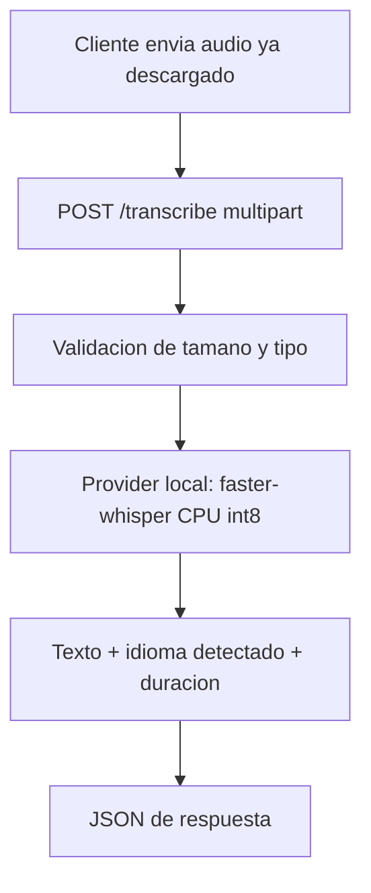

# Plan — `audio_processing` (transcripción de audio, local-first)

Estado: **borrador / investigación**. Primera versión: solo local.

## 1. Objetivo y alcance

Construir una **API que reciba un archivo de audio ya descargado y devuelva la
transcripción en texto**. Nada más. Es una herramienta independiente del bot:
solo exponemos el servicio de voz→texto.

### Dentro del alcance (v1)

- `POST /transcribe` con un archivo de audio (`multipart/form-data`) → texto plano + metadatos.
- Ejecución **100% local en CPU** (procesar el audio en la misma máquina, sin GPU).
- API autenticable con token opcional por `Authorization: Bearer`.
- Endpoints de soporte `/health` y `/providers` (mismo estilo que `image_generator`).

### Fuera del alcance (por ahora)

- El bot de WhatsApp y su integración (webhooks, descarga de media, envío de respuestas).
- Traducción entre idiomas (solo transcribir en el idioma original).
- TTS (texto→voz), diarización (separar hablantes), transcripción en streaming.
- Proveedores cloud (OpenAI, Groq, etc.): **se dejan listos a nivel de arquitectura, pero no se activan en v1**.

## 2. Decisiones congeladas

| # | Decisión |
|---|----------|
| 1 | Solo transcripción (sin traducción). |
| 2 | Local-first ahora; luego se escala a modelos cloud con el mismo patrón de proveedores. |
| 3 | v1: entra un audio descargado, sale el texto. Ese es todo el contrato. |
| 4 | El bot es otra herramienta; **aquí no se implementa nada del bot**. |
| 5 | Es una prueba; el plan se enfoca en la implementación local. |

Resueltas posteriormente:

| # | Decisión |
|---|----------|
| 2b | Idioma por defecto: **`es`** (autodetección con `language=auto`). |
| 3b | Tamaño de modelo por defecto: **`base`**. |
| 4b | **Incluir** el endpoint compatible OpenAI (`/v1/audio/transcriptions`) en v1. |
| 5b | Todo el código vive en `audio_processing/` (el plan permanece en `plans/`). |

## 3. Encaje en el proyecto

Reutilizamos el patrón ya validado en `image_generator/api`:

- `providers/base.py` con una ABC (contrato común), `registry.py` que instancia
  proveedores bajo demanda, `config.py` por variables de entorno, `schemas.py`
  con Pydantic y `main.py` con FastAPI.
- **Local por defecto**, cloud opcional (a futuro). El token de API es opcional.

> **Nota de nomenclatura:** la carpeta `voice_translator/` de la raíz está vacía y
> su nombre ya no describe el alcance real (solo transcribimos, no traducimos).
> Propuesta: **renombrar `voice_translator/` → `audio_processing/`** (o eliminarla
> y crear la nueva). Pendiente de confirmar (ver §11).

## 4. Arquitectura (v1, solo local)



Componentes:

- **API FastAPI**: recibe el archivo, lo pasa al proveedor y serializa el resultado.
- **Provider local**: `faster-whisper` (CTranslate2) en proceso, con `compute_type="int8"` para CPU.
- **Modelo**: pesos de Whisper (por defecto `small`), cacheados en un volumen; no versionados.

## 5. Motor local: elección y justificación

La máquina **no tiene GPU NVIDIA ni ROCm**, así que la prioridad es eficiencia en CPU.

| Opción | Pros | Contras | Veredicto |
|--------|------|---------|-----------|
| **faster-whisper** (CTranslate2) | Rápido en CPU con `int8`; sin `torch`; decodifica audio con PyAV; API Python simple | Dependencias binarias (ctranslate2) | **Elegido para v1** |
| whisper.cpp | Muy eficiente; servidor compatible OpenAI | Gestionar binario/modelos GGML aparte del servicio Python | Alternativa/futuro |
| openai-whisper | Referencia oficial | Necesita `torch`; lento en CPU | Descartado |

**Tamaño de modelo por defecto:** `base` (rápido en CPU; suficiente como punto de
partida). Configurable por entorno: `tiny` para ir aún más rápido, `small`/`medium`
si se prioriza calidad sobre latencia. Los pesos se descargan la primera vez y se cachean.

## 6. Contrato de la API

### `POST /transcribe` (principal)

- `Content-Type: multipart/form-data`
- Campos:
  - `file` (obligatorio): archivo de audio.
  - `language` (opcional, ISO-639-1): si se omite, autodetección.
  - `model` / `provider` (opcional): override.
  - `verbose` (opcional, bool): incluye segmentos con marcas de tiempo.

Respuesta `200` (JSON):

```json
{
  "text": "transcripción completa",
  "language": "es",
  "language_probability": 0.98,
  "duration": 12.3,
  "provider": "local",
  "model": "small",
  "segments": []
}
```

### Endpoints de soporte

- `GET /health` → estado + proveedores configurados.
- `GET /providers` → lista de proveedores y su estado.
- `GET /` → índice de endpoints.

### `POST /v1/audio/transcriptions` (compatible OpenAI) — **incluido en v1**

Mismo backend; acepta `file`, `model`, `language`, `response_format`
(`json` | `text` | `verbose_json`), `prompt` y `temperature` (estos dos últimos se
aceptan por compatibilidad pero no se usan todavía). Devuelve `{ "text": … }` en
`json`, el texto plano en `text`, o texto + idioma/duración/segmentos en `verbose_json`.

## 7. Formatos de audio y normalización

- Aceptamos los formatos comunes que **faster-whisper/PyAV** decodifican (wav, mp3, m4a, ogg/opus, flac, webm…).
- `ffmpeg` se instala igualmente en la imagen (robustez y futuras conversiones); para v1, PyAV cubre la decodificación.
- **Caso WhatsApp (a futuro):** las notas de voz son **Opus dentro de `.ogg`**. La v1 no lo trata de forma especial, pero se validará con un `.ogg` real en la fase de pruebas para no llevarnos sorpresas.
- Límite de subida configurable (`AUDIO_MAX_UPLOAD_MB`, por defecto p. ej. 25).

## 8. Configuración (variables de entorno)

Espejo de `image_generator/api/app/config.py`:

| Variable | Default | Uso |
|----------|---------|-----|
| `AUDIO_API_TOKEN` | `None` | Token Bearer opcional. |
| `AUDIO_PROVIDER` | `local` | Proveedor por defecto. |
| `AUDIO_MAX_UPLOAD_MB` | `25` | Tamaño máximo de subida. |
| `AUDIO_DEFAULT_LANGUAGE` | `es` | Idioma si la petición no especifica uno (`auto` = autodetección). |
| `LOCAL_WHISPER_MODEL` | `base` | Tamaño/nombre del modelo. |
| `LOCAL_WHISPER_DEVICE` | `cpu` | Dispositivo. |
| `LOCAL_WHISPER_COMPUTE_TYPE` | `int8` | Precisión (CPU-friendly). |
| `WHISPER_MODEL_DIR` | `./models` | Caché de pesos (volumen). |

## 9. Estructura de archivos propuesta

```
audio_processing/
├── Dockerfile
├── docker-compose.yml
├── requirements.txt
├── .dockerignore
└── api/
    ├── app/
    │   ├── __init__.py
    │   ├── config.py            # Settings (pydantic-settings)
    │   ├── schemas.py           # TranscribeResponse, ProviderInfo, HealthResponse
    │   ├── main.py              # FastAPI: /transcribe, /health, /providers
    │   ├── audio.py             # validación básica del archivo
    │   └── providers/
    │       ├── __init__.py
    │       ├── base.py          # TranscriptionProvider (ABC) + ProviderError
    │       ├── local_whisper.py # faster-whisper (default)
    │       └── registry.py      # ProviderManager
    └── tests/
        ├── conftest.py
        ├── test_api.py
        └── fixtures/sample.wav  # audio corto de prueba
```

Contrato del proveedor (`providers/base.py`), calcado del de imágenes:

```python
class TranscriptionProvider(ABC):
    name: ClassVar[str]

    @classmethod
    def is_configured(cls, settings) -> bool: ...

    @abstractmethod
    async def transcribe(self, request: TranscribeRequest) -> TranscriptResult: ...

    async def aclose(self) -> None: ...
```

## 10. Concurrencia y despliegue

- La transcripción es **CPU-bound y bloqueante**: se ejecuta fuera del event loop
  (threadpool / `anyio.to_thread`) y se protege el modelo con un lock para evitar
  llamadas concurrentes al mismo objeto (`WhisperModel` no es thread-safe en paralelo).
- El modelo se carga **una vez** y permanece en memoria (lifespan de FastAPI).
- `Dockerfile`: `python:3.13-slim` + `ffmpeg`, usuario no-root (mismo patrón que `image_generator`).
- `docker-compose.yml`: puerto **solo en loopback** (`127.0.0.1`), volumen para la
  caché de modelos, `restart: unless-stopped`.
- `.gitignore`: excluir `api/models/`, `api/.env`, `outputs/` si se guardan audios.

## 11. Pruebas

- **Test unitario/HTTP con proveedor falso** (igual que `image_generator`): no
  descarga modelos ni usa red; valida contrato, errores (sin `file` → 422) y token.
- **Smoke test local** (marcado/opcional): transcribir `fixtures/sample.wav` con
  faster-whisper real y verificar que el texto no está vacío.
- **Prueba manual con un `.ogg` (opus)** para anticipar el caso WhatsApp.

## 12. Fases

- **Fase 0 — Andamiaje** ✅
  - [x] Renombrar/crear `audio_processing/` y su estructura base.
  - [x] `providers/base.py` (ABC), `registry.py`, `schemas.py`, `config.py`.
  - [x] `main.py` con `/transcribe` (usando un `FakeProvider`) + `/health` + `/providers`.
  - [x] Tests con proveedor falso.
- **Fase 1 — Motor local real** ✅
  - [x] `providers/local_whisper.py` con faster-whisper (`int8`, `base`).
  - [x] Manejo de subida, validación y errores.
  - [x] `Dockerfile` + `docker-compose.yml` (loopback, volumen de modelos).
  - [x] `.dockerignore` / `.gitignore`.
  - [x] Endpoint compatible OpenAI (`/v1/audio/transcriptions`).
- **Fase 2 — Validación**
  - [x] `.ogg`/opus (caso WhatsApp) probado end-to-end en la API en Docker: texto correcto.
  - [ ] Probar más formatos reales (mp3, m4a) y medir latencia.
  - [x] Documentar uso en `audio_processing/README.md`.
  - [x] Smoke test del proveedor local (carga de modelo + decodificación + transcripción) OK.
- **Fase 3 — Futuro (no v1)**
  - [ ] Proveedores cloud (OpenAI/Groq) detrás del mismo `TranscriptionProvider`.
  - [ ] VAD para recortar silencios y evitar alucinaciones.

## 13. Criterios de aceptación de v1

- `docker compose up` levanta la API en CPU, en loopback, sin credenciales.
- `POST /transcribe` con un audio devuelve `text` correcto, `language` y `duration`.
- La primera ejecución descarga y cachea el modelo; las siguientes no re-descargan.
- Los tests con proveedor falso pasan sin red ni descarga de modelos.
- `/health` y `/providers` responden correctamente.

## 14. Riesgos y consideraciones

| Riesgo | Mitigación |
|--------|------------|
| Latencia alta en CPU para audios largos | Modelo `small`/`base` + `int8`; medir en Fase 2 |
| Primera descarga del modelo | Cachear en volumen; documentar el tamaño |
| `WhisperModel` concurrente | Lock + ejecución en threadpool |
| Alucinaciones con silencios | VAD (Fase 3) |
| Formatos exóticos (opus) | Probar `.ogg` real; `ffmpeg` disponible |
| `faster-whisper` 1.2.x incompatible con `av>=16` | Fijar `av<16` en `requirements.txt` (validado con smoke test) |
| Privacidad de audios | v1 no persiste audios; solo texto en memoria |

## 15. Decisiones resueltas

1. **Nombre del módulo:** `voice_translator/` renombrado a `audio_processing/`. ✅
2. **Idioma:** por defecto `es`; `language=auto` fuerza autodetección. ✅
3. **Tamaño de modelo:** `base`. ✅
4. **Endpoint compatible OpenAI:** incluido en v1. ✅
5. **Audios subidos:** no se persisten (solo se procesan en memoria).
