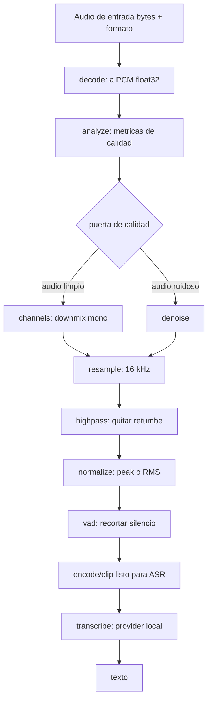

# Plan — Pipeline modular de preprocesamiento de audio

Estado: **implementado (v1)**. Complementa a
[`audio_processing.md`](audio_processing.md) (API de transcripción, ya implementada).

## 0. Punto de partida

Ya existe una API de transcripción (`POST /transcribe`) que pasa los bytes del audio
**tal cual** al motor local (faster-whisper). No hay limpieza previa. Este plan añade
una capa de **preprocesamiento modular**: piezas que funcionan sueltas y que se pueden
encadenar antes de transcribir.

## 1. Objetivo

1. Evaluar qué técnicas de preprocesamiento **mejoran de verdad** la transcripción.
2. Diseñar cada técnica como un **módulo independiente** (usable por separado).
3. Poder **encadenarlas** en un pipeline configurable que alimente a la transcripción.
4. Mantener todo **local/CPU** (coherente con la restricción del host, sin GPU).

## 2. Evaluación: ¿qué preprocesamiento sirve para ASR?

No todo suma. Un preprocesado agresivo puede **empeorar** el WER (introduce artefactos).
La recomendación es una **cadena mínima por defecto** y extras opt-in, midiendo siempre.

| Técnica | Para qué sirve | Impacto real en transcripción | Veredicto |
|---|---|---|---|
| Decodificar / convertir formato | opus/ogg/mp3/… → PCM | Imprescindible (WhatsApp = opus) | **Imprescindible** |
| Downmix a mono | estéreo → mono | Neutro/positivo; Whisper es mono | **Imprescindible** |
| Resample a 16 kHz | Whisper trabaja a 16 kHz | Imprescindible (evita dobles conversiones) | **Imprescindible** |
| Normalización de nivel (peak/RMS) | llevar a rango [-1, 1] | Ayuda con audio muy bajo o saturado | **Muy útil** |
| Filtro paso-alto (~80 Hz) | quitar retumbe/DC | Limpia sin dañar voz | **Muy útil** |
| VAD (detección de voz) | recortar silencio, trocear | Reduce cómputo y alucinaciones en silencios | **Muy útil** |
| Reducción de ruido | limpiar ruido de fondo | Mejora clara en audio ruidoso; daña si se abusa | **Condicional** |
| Análisis de calidad/frecuencia | SNR, clipping, DC, silencio | No extrae texto, pero **decide** si aplicar denoise | **Útil como diagnóstico** |
| De-reverberación (WPE) | salas con eco | Marginal en notas de voz | Opcional |
| Separación de fuentes (Demucs) | voz + música simultáneas | Ayuda si hay música fuerte; costoso | Opcional |
| Diarización (pyannote) | ¿quién habla y cuándo? | **No mejora el texto**; añade etiquetas de hablante | Solo si multi-hablante |

**Conclusiones clave:**

- **"Análisis de frecuencias" no es un paso para extraer texto**: el ASR no necesita un
  FFT explícito. Lo valioso es (a) un **paso-alto** y (b) un **analizador de calidad**
  (RMS, pico, clipping, DC offset, ratio de silencio, energía por banda) que sirva para
  **decidir** qué aplicar y para diagnosticar audios malos.
- **Separar voces ≠ diarizar.** Para una **nota de voz de WhatsApp (1 hablante)**,
  diarización y separación son innecesarias. Se dejan como módulos opt-in para casos
  multi-hablante o con música, no en la cadena por defecto.
- **El denoise es el más delicado**: RNNoise/DeepFilterNet ayudan en ruido real, pero en
  audio ya limpio pueden restar. Por eso va **detrás de un umbral** y es desactivable.

## 3. Flujo de trabajo (workflow)



Notas del flujo:

- **Orden**: decodificar → analizar → (denoise) → mono → resample → filtrar → normalizar → VAD → ASR.
  El denoise va antes del resample (muchos modelos esperan su propio sample rate, p. ej. 48 kHz).
- **Puerta de calidad** (`analyze`): decide si entra el denoise y deja constancia de por qué.
- Cada caja es un **módulo independiente** (sección 5) y el encadenado lo hace el **pipeline** (sección 4).
- **VAD**: faster-whisper ya trae VAD integrado (`vad_filter=True`, Silero). Nuestro módulo
  de VAD sirve para uso suelto y para trocear audio largo de forma explícita.

## 4. Arquitectura modular

Idea central: **pipes-and-filters** con un formato de intercambio común.

### 4.1 Formato de intercambio: `AudioClip`

```python
@dataclass
class AudioClip:
    samples: np.ndarray   # float32, forma (n,), rango [-1, 1]
    sample_rate: int
```

Todo módulo **consume y produce** un `AudioClip`. Así los pasos son combinables sin
acoplarse a bytes, ficheros o al motor de ASR.

### 4.2 Interfaz de un módulo: `Processor`

```python
class Processor(ABC):
    name: ClassVar[str]

    def __init__(self, **params) -> None: ...

    @abstractmethod
    def process(self, clip: AudioClip) -> AudioClip: ...

    def analyze(self, clip: AudioClip) -> dict:   # opcional (solo algunos)
        return {}
```

- **Síncrono y sin estado pesado** por diseño (los modelos se cargan de forma perezosa).
- La transcripción es CPU-bound; el pipeline se ejecutará en el mismo thread que el ASR.

### 4.3 Composición: `Pipeline`

```python
pipeline = Pipeline.from_preset("noisy")   # o desde lista de pasos
clip = pipeline.run(AudioClip(...))
report = pipeline.last_report           # métricas por paso
```

### 4.4 Tres formas de uso (requisito del usuario)

1. **Módulo suelto (Python)**: `resample.resample(clip, 16000)`.
2. **Módulo suelto (HTTP)**: `POST /preprocess/{paso}` → audio procesado + métricas.
3. **Compuesto**: pipeline declarativo (preset o lista) que también usa `/transcribe`.

### 4.5 Declarativo y configurable

- **Presets**: `raw`, `minimal` (mono+resample+highpass+normalize), `clean` (+VAD),
  `noisy` (+denoise vía puerta de calidad).
- Los pasos y parámetros se definen en `config.py`/YAML, y se pueden sobrescribir por petición.

## 5. Módulos

| Módulo | Responsabilidad | Entrada → Salida | Standalone |
|---|---|---|---|
| `decode` | bytes/ffmpeg → `AudioClip` | bytes → clip | `/preprocess/decode` |
| `analyze` | métricas de calidad (RMS, pico, clipping, DC, % silencio, energía por banda, SNR est.) | clip → clip + report | `/analyze` |
| `channels` | downmix estéreo→mono | clip → clip | `/preprocess/channels` |
| `resample` | remuestreo a 16 kHz | clip → clip | `/preprocess/resample` |
| `highpass` | filtro paso-alto (~80 Hz) | clip → clip | `/preprocess/highpass` |
| `normalize` | nivel peak/RMS (o LUFS) | clip → clip | `/preprocess/normalize` |
| `denoise` | reducción de ruido | clip → clip | `/preprocess/denoise` |
| `vad` | recorte de silencios / troceo | clip → clip o clips | `/preprocess/vad` |
| `diarize` *(opt-in)* | etiquetas de hablante | clip → segmentos+hablante | `/preprocess/diarize` |
| `separate` *(opt-in)* | separar voz de música/otras voces | clip → clips | `/preprocess/separate` |

## 6. Tecnologías por módulo

| Módulo | Tecnología principal | Alternativas | Notas CPU |
|---|---|---|---|
| decode/convert | **PyAV** (ya es dep. de faster-whisper) | ffmpeg CLI (ya en la imagen), `soundfile` | opus/ogg OK |
| resample | **`soxr`** (alta calidad, rápido) | `scipy.signal.resample_poly`, `torchaudio` | ligero |
| channels | **numpy** (media de canales) | — | trivial |
| highpass | **`scipy.signal`** (Butterworth) | `sox`/`ffmpeg` | ligero |
| normalize | **numpy** (peak/RMS); **`pyloudnorm`** si LUFS | ffmpeg `loudnorm` | ligero |
| analyze | **numpy + scipy** (FFT para stats, no para procesar) | `librosa` | ligero |
| denoise | **DeepFilterNet** (ONNX, CPU) | `noisereduce` (spectral gating), **RNNoise** (ffmpeg `arnndn`) | DFN muy bueno en CPU |
| vad | **Silero VAD** (onnxruntime) | `webrtcvad` | ya usado por faster-whisper |
| diarize *(opt-in)* | **pyannote.audio** | speechbrain, NeMo | requiere token HF; pesado |
| separate *(opt-in)* | **Demucs** | speechbrain (SepFormer) | pesado; solo si hay música |

Dependencias nuevas previstas: `numpy`, `scipy`, `soxr`, `onnxruntime`, `deepfilternet`,
`pyloudnorm` (opcional), `pyannote.audio`/`demucs` (opt-in, extras separados).

> Mantener las deps **opt-in** en un `requirements-extras.txt` para que la imagen base
> (transcripción + cadena mínima) siga siendo ligera.

## 7. Integración con la transcripción existente

- `LocalWhisperProvider` **no cambia de responsabilidad**: recibe audio ya listo.
- La API ejecuta el **pipeline** antes de llamar al proveedor:
  `bytes → pipeline.run() → AudioClip → provider.transcribe(clip)`.
- Se añade a `TranscribeRequest` un campo `preprocess` (preset o lista de pasos) y, si el
  pipeline corre, el proveedor recibe `samples`/`sample_rate` en vez de bytes crudos.
- **Retrocompatible**: sin `preprocess`, el comportamiento actual (bytes tal cual) se mantiene.

## 8. API propuesta

| Método | Ruta | Descripción |
|---|---|---|
| `GET` | `/processors` | Lista de módulos disponibles y sus parámetros. |
| `POST` | `/analyze` | Métricas de calidad de un audio. |
| `POST` | `/preprocess/{paso}` | Aplica **un** módulo; devuelve audio + métricas. |
| `POST` | `/preprocess` | Aplica una **lista/preset** de módulos. |
| `POST` | `/transcribe` | *(existente)* + parámetro `preprocess=preset|csv|none`. |

## 9. Estructura de archivos propuesta

```
audio_processing/api/app/
├── audio/
│   ├── __init__.py
│   ├── types.py            # AudioClip, Segment
│   ├── io.py               # decode/encode (PyAV), resample
│   └── upload.py           # validación de subidas
├── preprocessing/
│   ├── __init__.py
│   ├── base.py             # Processor (ABC) + ProcessorResult
│   ├── pipeline.py         # Pipeline (composición)
│   ├── registry.py         # autodescubre módulos
│   ├── presets.py          # raw | minimal | clean | noisy
│   ├── router_factory.py   # genera la API propia de cada módulo
│   ├── api.py              # /processors, /presets, /preprocess
│   └── modules/            # una carpeta por módulo
│       └── <nombre>/
│           ├── __init__.py # exporta PROCESSOR
│           ├── processor.py# lógica
│           └── router.py   # API propia
├── providers/              # (ya existe) transcripción
├── schemas.py  config.py  main.py
```

- `app/audio.py` (validación de subida) se movió al paquete `app/audio/`.
- Los pasos caros (`diarize`, `separate`, `denoise` DFN, `dereverb`, `lufs`) hacen
  **import perezoso** y se reportan como no disponibles si falta la dependencia.

## 10. Fases

- **Fase A — Núcleo de la cadena mínima** ✅
  - [x] `AudioClip` + `Processor` (ABC) + `Pipeline` + `registry`.
  - [x] `decode`, `channels`, `resample`, `highpass`, `normalize`.
  - [x] `/processors`, `/preprocess/{paso}`, `/preprocess` (preset `minimal`).
  - [x] Tests con audio sintético (sin modelos externos).
- **Fase B — Calidad y VAD** ✅
  - [x] `analyze` + métricas de calidad; `/analyze`.
  - [x] `vad` (Silero, vía faster-whisper) + preset `clean`.
  - [x] Integración con `/transcribe` (`preprocess=`).
- **Fase C — Denoise** ✅
  - [x] `denoise` con backend `spectral` (propio) y `deepfilternet` (opcional).
  - [x] Preset `noisy`.
- **Fase D — Opt-in pesados** ✅
  - [x] `dereverb` (nara_wpe), `diarize` (pyannote), `separate` (Demucs).
- **Fase E — Evaluación**
  - [ ] Mini-set de audios con WER antes/después por preset.

## 11. Riesgos y consideraciones

| Riesgo | Mitigación |
|---|---|
| Sobreprocesar y **empeorar** el WER | Cadena mínima por defecto; denoise tras umbral; medir WER |
| `denoise`/`separate` caros en CPU | Import perezoso; presets; extras separados |
| Orden de pasos incorrecto | Documentar y fijar el orden del pipeline |
| Resample a 16 kHz del ASR vs. del preproceso | Resample explícito una vez; pasar ndarray al modelo |
| Licencias de modelos (DFN, pyannote) | Revisar licencias; pyannote requiere token HF |
| Audios largos (chunking) | VAD + troceo por segmentos |

## 12. Preguntas abiertas

1. ¿Implementamos **todo** o priorizamos la cadena mínima (Fases A–B) primero?
2. ¿Incluimos `denoise` desde el inicio o solo cuando haya audio ruidoso real?
3. ¿`diarize`/`separate` entran ahora (opt-in) o se posponen?
4. ¿Normalización por **peak** (seguro para Whisper) o **LUFS** (más “fiel”)?
5. ¿Definimos un **mini-set de evaluación** (con WER) antes de fijar presets?
6. ¿Los pasos opt-in van en la misma imagen (extras) o en un contenedor aparte?
